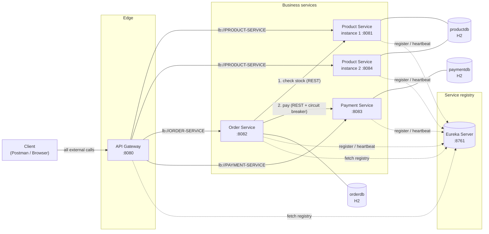
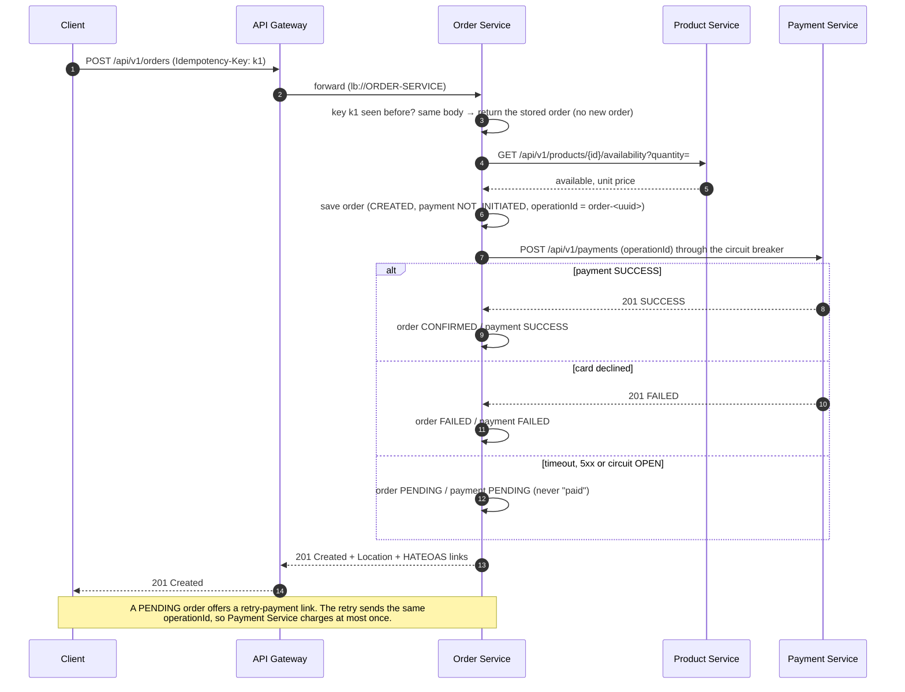

# E-Commerce Microservices — Teaching Project

A complete, locally runnable Spring Boot microservices system. It is used to teach
**microservices architecture** and **REST API best practices** in a 90-minute session
(trainer script: [DEMO-GUIDE.md](DEMO-GUIDE.md)).

**New here? Start with [EXECUTION-STEPS.md](EXECUTION-STEPS.md)**: how to start everything and test it
in Postman step by step, with the method, URL, headers and body for every request.

It runs on Java 21 with no Docker, Kubernetes or message broker. Each of the five
applications starts from Eclipse or the command line.

> **Status: complete (Phases 1–8).** All five applications build, 75 automated tests pass, and the
> full flow was run end to end through the API Gateway (see [Implementation plan](#implementation-plan)).

**Contents**
1. [Architecture](#1-architecture) · 2. [Technology stack](#2-technology-stack-and-version-compatibility) ·
3. [Services and ports](#3-services-ports-and-data-ownership) · 4. [API surface](#4-api-surface) ·
5. [Folder structure](#5-project-folder-structure) · 6. [Build and run](#6-build-and-run) ·
7. [Product API](#7-product-service-api) · 8. [Payment API](#8-payment-service-api) ·
9. [Order API](#9-order-service-api) · 10. [Concepts](#10-concepts-explained-with-this-project) ·
11. [Postman](#11-postman-sequence) · 12. [Expected outputs](#12-expected-outputs) ·
13. [Troubleshooting](#13-troubleshooting) · 14. [Tests](#14-tests)

---

## 1. Architecture



**How to read the diagram**

* **Solid arrows are HTTP requests.** Clients only talk to the **API Gateway**. The Gateway
  forwards each request to a healthy instance of the target service.
* **Dotted arrows are registry traffic, not requests.** Services *register* and send
  *heartbeats* to Eureka. Clients of the registry (the Gateway and Order Service) *fetch* the
  registry and cache it locally. **Eureka is never a hop on the request path.** It only
  answers "where are the instances of PRODUCT-SERVICE?".
* **Load balancing happens on the client side.** Spring Cloud LoadBalancer in the Gateway and
  in Order Service picks one of the cached instances, for example 8081 or 8084.
* **Database per service.** Each service owns its schema. Order Service never reads
  `productdb` or `paymentdb`; it calls the owning service's API instead.

> **Demo shortcut:** each Product Service instance runs an *in-memory* H2 database, so the two
> instances do not share data. Both seed the same five products in the same order, so ids 1–5
> are identical on both, but a product **you create** exists only on the instance that handled
> the POST. In production, all instances of a service share that service's real database
> (for example PostgreSQL).

### Order creation flow



---

## 2. Technology stack and version compatibility

The versions were checked on **2026-11-05** against the official Spring compatibility table
(<https://spring.io/projects/spring-cloud>, *"Release train Spring Boot compatibility"*) and
against Maven Central.

| Component | Version | Notes |
|---|---|---|
| Java | **21** (LTS) | `java.version=21` in every POM |
| Spring Boot | **4.1.2** | Latest GA. 4.2.0 is only at RC1. |
| Spring Cloud (BOM `spring-cloud-dependencies`) | **2025.1.4** "Oakwood" | Official table: *2025.1.x → Boot 4.0.x, 4.1.x (4.1.x starting with 2025.1.2)* |
| Spring Framework | 7.0.10 | Managed by Boot |
| Spring Cloud Gateway | 5.0.4 (`spring-cloud-starter-gateway-server-webflux`) | Reactive gateway, routes with `lb://` |
| Netflix Eureka (server and client) | eureka 2.0.6 / Spring Cloud Netflix 5.0.x | Managed by the Cloud BOM |
| Spring Cloud LoadBalancer | 5.0.4 (spring-cloud-commons) | Client-side load balancing |
| Resilience4j | 2.3.0 via `spring-cloud-starter-circuitbreaker-resilience4j` 5.0.3 | Managed by the Cloud BOM |
| Spring Data JPA / Hibernate | Hibernate ORM 7.4.13.Final | Managed by Boot |
| H2 | 2.4.240 | In-memory, one database per service |
| Spring HATEOAS | 3.1.3 | Order responses (RMM level 3) |
| springdoc-openapi | **3.2.0** | The 3.x line targets Spring Boot 4. 2.x targets Boot 3. |
| JUnit Jupiter / Mockito | 6.0.3 / 5.23.0 | See note below |
| Maven | 3.9.16 via Maven Wrapper 3.3.4 | No local Maven install needed |

**Why this pairing?**

* Boot **3.5.x** with Cloud **2025.0.x** is marked end-of-life on the official table, so a new
  teaching project should not start there.
* Cloud **2026.0.x** is only at RC1 and has no row in the compatibility table yet.
* Boot **4.1.2** with Cloud **2025.1.4** is the newest pairing that is both GA and officially
  supported. All versions come from the two BOMs (Boot parent and Cloud BOM). The only
  explicit version is springdoc, which is not part of either BOM.

**Spring Boot 4 / Spring Cloud 2025.1 points that matter for this course.** Requirement rule 9
says to flag framework conflicts; these are the ones that apply:

| Topic | What changed | What this project does |
|---|---|---|
| **"JUnit 5"** | Boot 4 ships **JUnit Jupiter 6**, the next major version of the same Jupiter API (`org.junit.jupiter.api.*`). | Tests are written exactly as in JUnit 5 (`@Test`, `@BeforeEach`, assertions). Only the version number differs. |
| Modular starters | `spring-boot-starter-web` is now `spring-boot-starter-webmvc`. Test slices have their own starters, such as `spring-boot-starter-webmvc-test` and `spring-boot-starter-data-jpa-test`. The H2 console is its own module, `spring-boot-h2console`. | The new names are used. |
| JSON | Jackson **3** (`tools.jackson.*`) is the default. | DTOs are plain Java records. Only `@JsonIgnoreProperties` (unchanged package `com.fasterxml.jackson.annotation`) is used, on client DTOs. |
| Gateway artifact | `spring-cloud-starter-gateway` is replaced by `spring-cloud-starter-gateway-server-webflux` / `-webmvc`. Properties live under `spring.cloud.gateway.server.webflux.*`. | The WebFlux (Netty) server is used. |
| Gateway forwarded headers | Since Gateway 4.1.x, `X-Forwarded-*` / `Forwarded` headers are only added when `trusted-proxies` is set. Without them, `Location` headers and HATEOAS links show the instance address (`192.168.x.x:8081`). | `trusted-proxies` is set to localhost in [api-gateway/application.yml](api-gateway/src/main/resources/application.yml). |
| Spring Data 4 | `PropertyReferenceException` moved to `org.springframework.data.core`. | Imported from the new package. |
| Resilience4j | The starter brings `resilience4j-spring-boot3`. On Boot 4 the actuator endpoints `/actuator/circuitbreakers` and `/actuator/circuitbreakerevents` work; the `circuitBreakers` **health** indicator does not register. | The circuit breaker is configured in code (`CircuitBreakerConfiguration`), not through `resilience4j.*` properties. The demo reads the state from the two actuator endpoints. |
| Eureka client + `@LoadBalanced RestClient.Builder` | The Eureka client builds its own HTTP client from the `RestClient.Builder` bean. If the only builder is `@LoadBalanced`, Eureka tries to resolve `localhost` as a service id and **cannot register**. | Order Service declares a plain `@Primary` builder for Eureka and a separate `@LoadBalanced` one for service calls ([RestClientConfig](order-service/src/main/java/com/example/order/config/RestClientConfig.java)). |

---

## 3. Services, ports and data ownership

| Application | Port | Eureka name | Owns database | Responsibility |
|---|---|---|---|---|
| `eureka-server` | 8761 | – | – | Service registry plus dashboard |
| `api-gateway` | 8080 | `API-GATEWAY` | – | Single entry point, routing, load balancing, timeouts, request logging, error mapping |
| `product-service` | 8081 (and 8084) | `PRODUCT-SERVICE` | `productdb` | Product catalogue, stock |
| `order-service` | 8082 | `ORDER-SERVICE` | `orderdb` | Order workflow, idempotency keys, circuit breaker to payment |
| `payment-service` | 8083 | `PAYMENT-SERVICE` | `paymentdb` | Simulated payments, operation-ID deduplication, failure-mode switch |

H2 consoles (demo only): `http://localhost:<port>/h2-console`, with JDBC URL `jdbc:h2:mem:<db>`
(`productdb`, `orderdb`, `paymentdb`), user `sa`, empty password.

Swagger UI on each business service: `http://localhost:<port>/swagger-ui/index.html`.

---

## 4. API surface

All external calls go through **`http://localhost:8080`**.

| Method | Path | Success | Purpose |
|---|---|---|---|
| POST | `/api/v1/products` | 201 + `Location` | Create product |
| GET | `/api/v1/products?page=&size=&sort=` | 200 | Paged list |
| GET | `/api/v1/products/{id}` | 200 | Get one |
| PUT | `/api/v1/products/{id}` | 200 | Full replace (idempotent) |
| PATCH | `/api/v1/products/{id}` | 200 | Partial update |
| DELETE | `/api/v1/products/{id}` | 204 | Delete |
| GET | `/api/v1/products/{id}/availability?quantity=` | 200 | Stock check used by Order Service |
| GET | `/api/v2/products/{id}` | 200 | v2 representation (versioning demo) |
| POST | `/api/v1/orders` (header `Idempotency-Key`) | 201 + `Location` | Create order |
| GET | `/api/v1/orders?page=&size=&sort=` | 200 | Paged list (HAL) |
| GET | `/api/v1/orders/{id}` | 200 | Get one, with HATEOAS `_links` |
| POST | `/api/v1/orders/{id}/retry-payment` | 200 | Retry payment of a `PENDING` order |
| POST | `/api/v1/payments` | 201 (new) / 200 (duplicate `operationId`) | Process payment |
| GET | `/api/v1/payments/{id}` | 200 | Get payment |
| GET | `/api/v1/payments?operationId=` or `?orderId=` | 200 | Find payments |
| GET/POST | `/api/v1/payments/test/failure-mode` | 200 | **Demo only**: switch the simulated provider between `NONE`, `ERROR`, `SLOW`, `DECLINE` |

Errors use RFC 9457 `application/problem+json`, with status codes 400, 404, 409, 500, 503 and 504.

Operational endpoints (direct, not through the Gateway):

| URL | Shows |
|---|---|
| <http://localhost:8761> | Eureka dashboard |
| <http://localhost:8080/actuator/gateway/routes> | Gateway route table |
| <http://localhost:8082/actuator/circuitbreakers> | Payment circuit breaker state and failure rate |
| <http://localhost:8082/actuator/circuitbreakerevents> | Every call, error and state transition |
| `http://localhost:<port>/actuator/health` | Health, including DB and Eureka |

---

## 5. Project folder structure

```text
Micro Services/
├── pom.xml                 # aggregator only: builds all five modules with one command
├── mvnw, mvnw.cmd, .mvn/   # Maven Wrapper (downloads Maven 3.9.16 on first run)
├── README.md
├── DEMO-GUIDE.md           # 90-minute trainer walkthrough
├── postman/                # collection and environment
├── eureka-server/          # com.example.eureka
├── api-gateway/            # com.example.gateway
│   └── filter/ error/      # request logging + correlation id, problem+json for gateway errors
├── product-service/        # com.example.product
│   └── src/main/java/com/example/product/
│       ├── controller/     # HTTP only: ResponseEntity, status codes, headers
│       ├── service/        # business interfaces
│       ├── service/impl/   # business logic and @Transactional boundaries
│       ├── repository/     # Spring Data JPA
│       ├── entity/         # JPA entities (never returned from controllers)
│       ├── dto/request/    # validated, immutable request records
│       ├── dto/response/   # response records
│       ├── mapper/         # entity <-> DTO
│       ├── exception/      # custom exceptions plus @RestControllerAdvice (ProblemDetail)
│       └── config/         # OpenAPI, demo data
│   └── src/main/resources/openapi/product-api.yaml   # spec-first OpenAPI 3.1 contract
├── order-service/          # com.example.order (same layering, plus client/ for downstream calls)
└── payment-service/        # com.example.payment (same layering)
```

Every module has `spring-boot-starter-parent` as its own parent, so each one is an
**independent application**. The root `pom.xml` is only for convenience: it is not a parent,
and no code is shared between services. (The three exception handlers look alike on purpose:
sharing a library between services couples their release cycles.)

---

## 6. Build and run

### Prerequisites
* JDK 21 on `PATH` or in `JAVA_HOME`.
* Internet access on the first build, to download Maven and dependencies.
* Maven itself is **not** required: use `mvnw.cmd` on Windows or `./mvnw` in bash.

### Build and test everything
From the project root (in PowerShell the leading `.\` is required):
```powershell
.\mvnw.cmd clean verify
```
Stop the running applications first: `clean` deletes the `target` folders they run from.

### Startup order
Open one terminal per application. In each one, `cd` into the service folder and run the
wrapper from the parent folder (`..\mvnw.cmd`). No `-f` is needed because the service's
`pom.xml` is in the current folder.

| # | Application | Folder | Command (run inside the folder) |
|---|---|---|---|
| 1 | Eureka Server | `eureka-server` | `..\mvnw.cmd spring-boot:run` |
| 2 | Product Service #1 | `product-service` | `..\mvnw.cmd spring-boot:run` |
| 3 | Product Service #2 | `product-service` | `..\mvnw.cmd spring-boot:run "-Dspring-boot.run.arguments=--server.port=8084"` |
| 4 | Payment Service | `payment-service` | `..\mvnw.cmd spring-boot:run` |
| 5 | Order Service | `order-service` | `..\mvnw.cmd spring-boot:run` |
| 6 | API Gateway | `api-gateway` | `..\mvnw.cmd spring-boot:run` |

Example (PowerShell, starting from the project root):
```powershell
cd eureka-server
..\mvnw.cmd spring-boot:run
```

In bash, use `../mvnw spring-boot:run` instead.

> You can also run everything from the project root with
> `.\mvnw.cmd -f <folder>\pom.xml spring-boot:run`. Do not combine the two styles: `-f eureka-server\pom.xml`
> only works from the root, not from inside `eureka-server`.

Start Eureka first so that services register immediately. The others retry if it is late.
Start the Gateway last so its first registry fetch already lists every service.
Wait until the Eureka dashboard (<http://localhost:8761>) lists all instances (about 10–30 s).

### Eclipse
1. *File → Import → Maven → Existing Maven Projects*, then select the project root. Eclipse imports
   the aggregator and all five modules.
2. Run each `*Application` class as a *Java Application*, in the order above.
3. For the second Product Service instance, duplicate the run configuration and add the
   program argument `--server.port=8084`.

---

## 7. Product Service API

Call it through the Gateway: **`http://localhost:8080`**. On start-up each instance seeds five
demo products (ids 1–5). `HEADSET-BT` (id 5) has stock 0.

For requests with a body, set the header `Content-Type: application/json`.

| # | Request | Body | Expected |
|---|---|---|---|
| 1 | `GET /api/v1/products` | – | 200, page with 5 products |
| 2 | `GET /api/v1/products?page=0&size=2&sort=price,desc` | – | 200, the 2 most expensive products, `totalPages: 3` |
| 3 | `GET /api/v1/products/1` | – | 200, the laptop |
| 4 | `POST /api/v1/products` | `{"sku":"TABLET-10","name":"Tablet","description":"10-inch tablet","price":299.00,"stockQuantity":25}` | 201, `Location: http://localhost:8080/api/v1/products/6` |
| 5 | Same POST again | same | 409 `Duplicate SKU` (if it reaches the same instance, see section 1) |
| 6 | `POST /api/v1/products` | `{"sku":"x","name":"","price":-1}` | 400, `errors` lists all 4 invalid fields |
| 7 | `PUT /api/v1/products/1` | `{"sku":"LAPTOP-15","name":"Laptop Pro","description":"16 GB","price":1099.00,"stockQuantity":10}` | 200, every field replaced |
| 8 | `PATCH /api/v1/products/1` | `{"price":949.00}` | 200, only the price changed |
| 9 | `GET /api/v1/products/1/availability?quantity=11` | – | 200, `available: false` (stock is 10) |
| 10 | `GET /api/v1/products/1/availability?quantity=0` | – | 400 |
| 11 | `GET /api/v2/products/1` | – | 200, v2 shape: `price: {amount, currency}`, `stock: {quantity, inStock}` |
| 12 | `DELETE /api/v1/products/4` | – | 204, no body |
| 13 | `GET /api/v1/products/999` | – | 404 `Product not found` |
| 14 | `GET /api/v1/products?sort=foo` | – | 400 `Invalid sort property` |

> With two instances, a write (POST/PUT/PATCH/DELETE) changes only the instance that handled
> it. To demo CRUD on one consistent dataset, stop the second instance or call 8081 directly.

### HTTP methods and status codes used

| Method | Safe | Idempotent | Used for | Success |
|---|---|---|---|---|
| GET | yes | yes | Read one or a page | 200 |
| POST | no | **no** (a second call creates a second resource) | Create | 201 + `Location` |
| PUT | no | yes (sending the same body twice gives the same state) | Full replace | 200 |
| PATCH | no | not guaranteed | Partial update | 200 |
| DELETE | no | yes (the resource is gone either way; a repeat call gives 404) | Delete | 204 |

| Status | Meaning in this system |
|---|---|
| 400 Bad Request | Invalid body, malformed JSON, wrong parameter type, unknown sort property, missing `Idempotency-Key` |
| 404 Not Found | The product / order / payment id does not exist, or no Gateway route matches |
| 409 Conflict | Valid request, but it clashes with current state: duplicate SKU, out of stock, `Idempotency-Key` reused with another body, `operationId` reused with another amount, retry on a non-PENDING order, concurrent update (`@Version`) |
| 500 Internal Server Error | A bug. The details are logged, never returned to the client |
| 503 Service Unavailable | A downstream service is down or has no registered instance (`Retry-After` from Payment) |
| 504 Gateway Timeout | A downstream service did not answer in time |

Every error body is RFC 9457 `application/problem+json`, for example:

```json
{
  "type": "https://example.com/problems/product-not-found",
  "title": "Product not found",
  "status": 404,
  "detail": "Product with id 999 was not found",
  "instance": "/api/v1/products/999",
  "productId": 999
}
```

### Design points to discuss in class
* **Layers.** The controller handles HTTP only. The service holds the business rules and
  `@Transactional` boundaries. Entities never leave the service; the API exposes record DTOs.
* **Validation at the edge.** `@Valid` on request bodies, and constraints on `@RequestParam`.
  All invalid fields are reported in one response, not only the first one.
* **Pagination.** Use `?page=&size=&sort=`. The size is capped at 100. The response uses a stable
  `PageResponse` shape instead of Spring's internal `PageImpl` JSON.
* **Availability is not an error.** Not enough stock is a valid answer (`available: false`, 200).
  A 4xx status means the *request* was wrong.
* **Behind a proxy.** `server.forward-headers-strategy: framework` makes the `Location` header use
  the Gateway's address (`localhost:8080`), taken from the `X-Forwarded-*` headers.

---

## 8. Payment Service API

| Request | Body | Expected |
|---|---|---|
| `POST /api/v1/payments` | `{"operationId":"demo-1","orderId":1,"amount":10.00}` | 201, `status: SUCCESS` |
| Same request again | same | **200**, same payment id: not charged twice |
| Same `operationId`, `amount: 99.00` | | 409 `operationId conflict` |
| `GET /api/v1/payments?operationId=demo-1` | – | 200, list with one payment |
| `POST /api/v1/payments/test/failure-mode` | `{"mode":"ERROR"}` | 200; the next payments get 503 + `Retry-After: 10` |

**Failure modes** (demo switch, per instance, reset on restart):

| Mode | Simulated provider | Payment API answers | Order becomes | Counts for the circuit breaker? |
|---|---|---|---|---|
| `NONE` | works | 201 `SUCCESS` | `CONFIRMED` | success |
| `DECLINE` | declines the card | 201 `FAILED` | `FAILED` | **no**: a business result, not an outage |
| `ERROR` | is down | 503, nothing stored | `PENDING` | yes |
| `SLOW` (`delayMs`, default 5000) | answers late, then succeeds | 201 after the delay | `PENDING` (Order Service gave up after 2 s) | yes |

---

## 9. Order Service API

`POST /api/v1/orders` needs the header **`Idempotency-Key`** (any unique string, for example a UUID):

```http
POST http://localhost:8080/api/v1/orders
Content-Type: application/json
Idempotency-Key: 3f0c6c1e-1d52-4a0f-9a6b-0f5a1c2b7e11

{"productId": 2, "quantity": 3}
```

Response (201, `Content-Type: application/hal+json`, `Location: http://localhost:8080/api/v1/orders/1`,
`Idempotent-Replayed: false`):

```json
{
  "id": 1,
  "productId": 2,
  "quantity": 3,
  "unitPrice": 24.99,
  "totalAmount": 74.97,
  "currency": "EUR",
  "status": "CONFIRMED",
  "paymentStatus": "SUCCESS",
  "paymentId": 1,
  "paymentOperationId": "order-0b9e0a3c-6f8a-4a51-9a47-1d3c2f2a8f10",
  "failureReason": null,
  "createdAt": "2026-11-05T09:41:55.6Z",
  "updatedAt": "2026-11-05T09:41:55.7Z",
  "_links": {
    "self":    { "href": "http://localhost:8080/api/v1/orders/1" },
    "orders":  { "href": "http://localhost:8080/api/v1/orders" },
    "product": { "href": "http://localhost:8080/api/v1/products/2" },
    "payment": { "href": "http://localhost:8080/api/v1/payments/1" }
  }
}
```

A `PENDING` order has no `payment` link but a **`retry-payment`** link instead.

| Situation | Result |
|---|---|
| Same key, same body again | 201, the **same** order, `Idempotent-Replayed: true` |
| Same key, different body | 409 `Idempotency-Key reused` |
| Same key while the first request is still running | 409 `Request in progress` |
| No `Idempotency-Key` header | 400 |
| Not enough stock | 409 `Insufficient stock` (with `requested` and `available`); the key is freed |
| Unknown product | 404 `Product not found` |
| Product Service down / slow | 503 / 504 |
| Payment declined / payment unclear | 201 with `FAILED` / `PENDING` |
| `POST /orders/{id}/retry-payment` on a non-PENDING order | 409 |

**Order states:** `CREATED → CONFIRMED | FAILED | PENDING`, and `PENDING → (retry-payment) → CONFIRMED | FAILED | PENDING`.

**Simplification:** stock is *checked*, not *reserved*. Two orders can both pass the check for
the last unit. A real shop would reserve stock (or use a saga). This keeps the demo focused.

---

## 10. Concepts explained with this project

### 10.1 Idempotency
An operation is idempotent if doing it twice has the same effect as doing it once. GET, PUT and
DELETE are idempotent by definition; **POST is not**. Networks fail *after* the server has done the
work but *before* the client gets the answer, so clients retry, and a retried POST would create a
second order or a second charge. This project makes the two dangerous POSTs safe:

| Where | Key | Stored in | Duplicate gets | Different payload, same key |
|---|---|---|---|---|
| `POST /orders` | `Idempotency-Key` header, chosen by the client | `idempotency_records` table (key is the primary key) + SHA-256 of the body | the original order, `Idempotent-Replayed: true` | 409 |
| `POST /payments` | `operationId` in the body, chosen by Order Service (`order-<uuid>`, stored on the order) | unique constraint on `payments.operation_id` | the original payment, 200 | 409 |

Why in the **database** and not in memory? It survives restarts, works with several instances,
and the unique constraint wins every race: two simultaneous requests cannot both insert the key.
The `IN_PROGRESS` row is committed **before** the slow remote calls start, so a concurrent duplicate
sees it and gets 409 instead of creating a second order.

### 10.2 Synchronous vs asynchronous communication
Order Service calls Product and Payment **synchronously** (REST, wait for the answer): it cannot
create an order without a price and must tell the client whether payment worked.
The cost is **temporal coupling**: if Payment is down, order creation is affected. This project
limits the damage with timeouts, a circuit breaker and a safe `PENDING` state.
**Asynchronous** messaging (Kafka, RabbitMQ) would remove the coupling: Order Service would publish
`OrderCreated` and Payment would react later; the order would be `PENDING` until a
`PaymentCompleted` event arrives. It needs a broker, eventual consistency and the outbox pattern,
so it is left out on purpose ("no message broker" is a course constraint).

### 10.3 Service discovery
Instances register with **Eureka** at start-up (name, host, port) and renew with a heartbeat every
5 s (demo value; default 30 s). If heartbeats stop for 15 s the instance is evicted. Callers
(Gateway, Order Service) fetch the registry every 5 s, cache it, and **pick an instance themselves**
(client-side load balancing, round-robin). No URL in the code contains a host or port:
`lb://PRODUCT-SERVICE` and `http://PRODUCT-SERVICE` are resolved at call time.
*Self-preservation* is switched off on the demo Eureka so dead instances disappear quickly;
keep it on in production.

### 10.4 API Gateway
The single entry point: clients know one address, services stay private. This gateway does
**routing** (path → service), **load balancing** (`lb://`), **timeouts** (connect 2 s, response 5 s →
504), **correlation ids** (`X-Request-Id` added and forwarded), **request logging**
(`method path → instance status duration`), **`X-Served-By`** (which instance answered) and
**uniform errors** (its own 404/503/504 are problem+json too). Typical additions in production:
authentication (JWT validation), rate limiting, CORS, request size limits.

### 10.5 Retry vs Timeout vs Circuit Breaker

| | Question it answers | Here | Risk if misused |
|---|---|---|---|
| **Timeout** | "How long do I wait for one call?" | Order → Product/Payment: 2 s read timeout; Gateway: 5 s | Without one, a hanging service blocks threads forever |
| **Retry** | "Should I try again?" | **Not automatic.** A client-driven `retry-payment` with the same `operationId` | Retrying a non-idempotent call can charge twice; blind retries add load to a struggling service |
| **Circuit breaker** | "Should I even call it right now?" | Around the payment call | Opening on business errors (declines, 4xx) would block healthy traffic, so they are excluded |

Payment circuit breaker settings ([application.yml](order-service/src/main/resources/application.yml)):

```text
window: last 4 calls · OPEN when ≥ 50% failed · OPEN for 15 s · then HALF_OPEN with 2 trial calls
CLOSED ──≥50% of last 4 failed──▶ OPEN ──15 s──▶ HALF_OPEN ──2 trials OK──▶ CLOSED
                                    ▲                │
                                    └──trial fails───┘
```

While OPEN, the payment call is not made at all; the fallback answers in a few milliseconds and
the order becomes `PENDING` with the reason *"Payment circuit breaker is OPEN"*. Follow it live in
`/actuator/circuitbreakers` and `/actuator/circuitbreakerevents` on port 8082.

**Rule of thumb:** timeout on every remote call; retry only idempotent operations, with backoff and
a limit; circuit breaker around dependencies that can fail as a whole.

### 10.6 Statelessness and JWT
Every service is **stateless**: no HTTP session, no in-memory user state. Any instance can serve
any request, which is why the Gateway can send consecutive calls to 8081 and 8084. (The only
in-memory state, Payment's failure-mode switch, is a demo control and is documented as per-instance.)
Authentication would follow the same rule with **JWT**: the client sends `Authorization: Bearer <token>`;
the Gateway (or each service, with `spring-boot-starter-oauth2-resource-server`) validates the
signature and expiry locally, without a session store or a call to the identity provider per request.
Security is out of scope for this 90-minute session, so the endpoints are open.

### 10.7 Richardson Maturity Model

| Level | Meaning | In this project |
|---|---|---|
| 0 | One URL, one verb (RPC over HTTP) | – |
| 1 | Resources: one URL per thing | `/products/{id}`, `/orders/{id}`, `/payments/{id}` |
| 2 | HTTP verbs and status codes used correctly | GET/POST/PUT/PATCH/DELETE, 201 + `Location`, 204, 400/404/409, problem+json — all three services |
| 3 | Hypermedia (HATEOAS) | Order Service responses carry `_links` |

### 10.8 HATEOAS
Order responses are **HAL** (`application/hal+json`). The links tell the client what it can do next,
and they depend on the state: `retry-payment` appears only for `PENDING` orders, `payment` only when a
payment exists. A client that follows `_links.retry-payment.href` instead of building
`/orders/{id}/retry-payment` itself keeps working when the URL changes. Links point at the Gateway
because they are built from the forwarded headers. The collection (`GET /orders`) is a HAL page
with `_embedded.orders`, `page` metadata and `first/next/last` links.

### 10.9 API versioning
**URI versioning**: `/api/v1/products/{id}` and `/api/v2/products/{id}` serve the same data in two shapes
(v2: `price` becomes `{amount, currency}`, stock becomes `{quantity, inStock}`). A breaking change gets a
new version; v1 clients are not affected. Adding a field is **not** breaking and does not need a new
version. Alternatives: a header (`API-Version: 2`) or media type (`Accept: application/vnd.shop.v2+json`);
URI versioning is the most visible and the easiest to route and cache.

### 10.10 Spec-first OpenAPI
The Product API contract is written **first**, by hand, in
[product-api.yaml](product-service/src/main/resources/openapi/product-api.yaml) (OpenAPI 3.1): it is
what you agree with consumers before any code exists. springdoc also **generates** a document from the
code (`/v3/api-docs`, also 3.1). Swagger UI on 8081 shows both (drop-down top right).
`OpenApiContractTest` compares them on every build: if an endpoint is added, removed or renamed in the
code but not in the contract (or the other way round), the build fails. Order and Payment Service use
code-first (generated) documentation only, so both approaches can be compared in class.

---

## 11. Postman sequence

Import [postman/ecommerce-microservices.postman_collection.json](postman/ecommerce-microservices.postman_collection.json)
and [postman/ecommerce-local.postman_environment.json](postman/ecommerce-local.postman_environment.json),
then select the environment **E-Commerce local**.

| Folder | What it shows | Runner? |
|---|---|---|
| 00 Discovery and gateway | Eureka registry, gateway route table | yes |
| 01 Products | CRUD, paging and sorting, validation, 409, 404, v2 | yes* |
| 02 Load balancing | Send several times, compare `X-Served-By` (8081 / 8084) | yes |
| 03 Orders, idempotency, HATEOAS | New key → 201; same key → replay; other body → 409; no key → 400; out of stock; HAL links | yes |
| 04 Payments | `operationId` deduplication: 201, then 200 with the same id, then 409 | yes |
| 05 Resilience | DECLINE → FAILED; ERROR → PENDING ×4 → circuit OPEN; NONE; wait 15 s; retry-payment → CONFIRMED; SLOW → timeout → PENDING → retry → CONFIRMED with one payment | **no**, run step by step |
| 06 Gateway errors | 404 problem+json from the gateway itself | yes |

\* Folder 01 creates, changes and deletes one product. With two Product instances the requests can
land on different instances (section 1); run it with only instance 8081 started, or point a copy of
`baseUrl` at `http://localhost:8081`.

Every request contains tests (`pm.test`) that check the expected status, so folder runs double as
smoke tests. Folder 05 depends on timing (15 s in OPEN) and on the payment failure mode, so run it
request by request while watching `/actuator/circuitbreakers`.

---

## 12. Expected outputs

**Eureka dashboard** (<http://localhost:8761>), *Instances currently registered*:

```text
API-GATEWAY      UP (1) - api-gateway:8080
ORDER-SERVICE    UP (1) - order-service:8082
PAYMENT-SERVICE  UP (1) - payment-service:8083
PRODUCT-SERVICE  UP (2) - product-service:8081 , product-service:8084
```

**Load balancing:** four calls of `GET /api/v1/products/1` through the Gateway return
`X-Served-By: <ip>:8081`, `:8084`, `:8081`, `:8084`.

**Gateway log** (one line per request):

```text
INFO ... RequestLoggingFilter : 40cc6422-... GET /api/v1/products/1 -> 192.168.1.9:8084 status=200 OK 12ms
```

**Circuit breaker walk-through** (recorded end-to-end run, payment mode `ERROR`; the last 4 calls
before it included 2 successes):

```text
order 3: PENDING - Payment Service returned 503 SERVICE_UNAVAILABLE    breaker=CLOSED
order 4: PENDING - Payment Service returned 503 SERVICE_UNAVAILABLE    breaker=OPEN
order 5: PENDING - Payment circuit breaker is OPEN: payment was not attempted   (48 ms)
mode -> NONE, wait 15 s                                                 breaker=HALF_OPEN
retry order 3: CONFIRMED                                                breaker=HALF_OPEN
retry order 4: CONFIRMED                                                breaker=CLOSED
```

Order Service log:

```text
WARN ... CircuitBreakerConfiguration : Circuit breaker 'payment': State transition from CLOSED to OPEN
WARN ... CircuitBreakerConfiguration : Circuit breaker 'payment': State transition from OPEN to HALF_OPEN
WARN ... CircuitBreakerConfiguration : Circuit breaker 'payment': State transition from HALF_OPEN to CLOSED
```

**Timeout + no double charge** (payment mode `SLOW`, 3000 ms):

```text
order 8: PENDING - Payment Service did not answer in time (2058 ms)
payments stored for its operationId (provider finished late): 1
retry-payment -> CONFIRMED
payments for its operationId after retry: 1        ← Payment Service returned the stored payment
```

---

## 13. Troubleshooting

| Symptom | Cause | Fix |
|---|---|---|
| `mvnw.cmd : The term ... is not recognized` | PowerShell does not run files from the current folder without a path | Use `.\mvnw.cmd` (root) or `..\mvnw.cmd` (service folder) |
| *The directory name is invalid* | `-f eureka-server\pom.xml` used inside `eureka-server` | Inside a service folder run `..\mvnw.cmd spring-boot:run` without `-f` |
| `Port 8080 was already in use` | An earlier run is still alive | Stop it (Ctrl+C in its terminal), or `Get-NetTCPConnection -LocalPort 8080` to find the PID |
| Gateway returns **503** `Service Unavailable` | Target service not started, not yet registered, or not yet in the Gateway's cache | Check the Eureka dashboard; wait 10–30 s after a service starts |
| A service is missing from Eureka | It started before Eureka and is still retrying, or it crashed | Look at its console; it registers within ~30 s once Eureka is up |
| Stopped instance still gets traffic for a few seconds | Eviction (15 s) + registry fetch (5 s) + LoadBalancer cache (5 s) | Expected; it is the eventual consistency of discovery |
| `Location` / `_links` show `192.168.x.x:8081` instead of `localhost:8080` | Service called directly, or Gateway without `trusted-proxies` | Call through `http://localhost:8080` |
| Created product returns 404 on the next GET | Two Product instances, each with its own in-memory DB | Expected in the demo (section 1); stop the second instance for CRUD demos |
| Every order becomes `PENDING` | Payment failure mode is not `NONE`, or the circuit is OPEN | `POST /api/v1/payments/test/failure-mode {"mode":"NONE"}`, wait 15 s, check `/actuator/circuitbreakers` |
| `POST /orders` → 409 *Request in progress* | Same `Idempotency-Key` sent twice in parallel | Wait for the first request; then the retry gets the stored order |
| `POST /orders` → 409 *Idempotency-Key reused* | Same key with a different body | Use a new key for a new order (Postman: `{{$guid}}`) |
| `mvnw clean verify` fails deleting `target` | Applications still running from those folders | Stop them first, or run `verify` without `clean` |
| H2 console login fails | Wrong JDBC URL | `jdbc:h2:mem:productdb` (or `orderdb` / `paymentdb`), user `sa`, empty password |
| All data gone after restart | H2 is in memory (`create-drop`) | Expected; demo data is seeded again on start |

---

## 14. Tests

```powershell
.\mvnw.cmd clean verify     # project root: all modules
..\mvnw.cmd verify          # inside one service folder
```

| Module | Test class | Type | What it checks |
|---|---|---|---|
| product | `ProductServiceImplTest` | Unit (Mockito) | Duplicate SKU, not found, PATCH semantics, availability |
| product | `ProductControllerTest` | `@WebMvcTest` | Status codes, `Location`, validation, problem+json, v2 shape |
| product | `ProductRepositoryTest` | `@DataJpaTest` | Unique SKU constraint, derived queries, paging and sorting |
| product | `OpenApiContractTest` | `@SpringBootTest` | Code and spec-first contract describe the same operations; contract is OpenAPI 3.1 |
| payment | `PaymentServiceImplTest` | Unit | Dedup without re-charging, 409 on mismatch, DECLINE stored, ERROR stores nothing |
| payment | `PaymentControllerTest` | `@WebMvcTest` | 201 vs 200 for duplicates, 409, 503 + `Retry-After`, failure-mode switch |
| payment | `PaymentRepositoryTest` | `@DataJpaTest` | `operationId` unique at database level |
| order | `OrderServiceImplTest` | Unit | CONFIRMED / FAILED / PENDING, key released on failure, replay skips downstream calls, retry reuses the operationId |
| order | `IdempotencyServiceTest` | `@DataJpaTest` (real commits) | New key, replay, body mismatch, in-progress, release |
| order | `OrderControllerTest` | `@WebMvcTest` | 201 + `Location`, HAL `_links` by state, replay header, 400/404/409/504 |
| order | `PaymentClientCircuitBreakerTest` | Unit + `MockRestServiceServer` | CLOSED → OPEN → (no call while OPEN) → HALF_OPEN → CLOSED; declines and 4xx do not open it |
| gateway | `GatewayRoutingTest` | `@SpringBootTest` (random port) | Route table uses `lb://`; 404 and 503 as problem+json; `X-Request-Id` echoed |
| all | `*ApplicationTests` | `@SpringBootTest` | Each context starts |

Total: **75 tests**. In addition, the complete flow (sections 11 and 12) was run end to end through
the Gateway with two Product instances.

---

## Implementation plan

| Phase | Scope | Status |
|---|---|---|
| 1 | Workspace, versions, root structure, wrapper, module skeletons, architecture, README | **Done** |
| 2 | Product Service: CRUD, pagination, validation, ProblemDetail errors, availability endpoint, v2 view, OpenAPI 3.1 spec, unit, MockMvc and `@DataJpaTest` tests | **Done** |
| 3 | Payment Service: processing, `operationId` uniqueness and deduplication, demo failure switch, tests | **Done** |
| 4 | Order Service: load-balanced `RestClient`, order workflow, DB-backed `Idempotency-Key` (unique constraint, payload hash, 409 on mismatch), HATEOAS, tests | **Done** |
| 5 | Eureka tuning, Gateway routes (`lb://`), timeouts, request logging, error mapping, two Product instances | **Done** |
| 6 | Resilience4j circuit breaker on payment (CLOSED → OPEN → HALF_OPEN → CLOSED), safe `PENDING` fallback, Actuator endpoints | **Done** |
| 7 | OpenAPI check, HATEOAS and versioning check, Postman collection and environment, full README sections, `DEMO-GUIDE.md` | **Done** |
| 8 | Full build and tests, end-to-end run through the Gateway | **Done**: 75 tests pass; end-to-end run recorded in section 12 |
